# Diagrama de clases - Hito 2 (Epicentro Gourmet)

Iteración del diagrama del Hito 1 (fuente editable del Hito 1: [`oo2UML.dia`](oo2UML.dia)). GitHub dibuja el diagrama de abajo directamente.

**Cambios respecto al Hito 1**
- `Cocinero` pasa a tener `rolCocina` (cocinero, ayudante, lavaplatos) en vez de `especialidad`; `Cajero` tiene `turno` (mañana/noche) y cobra antigüedad.
- Nueva `CostoFestival`: encapsula los costos del festival (costo por m², plus eléctrico, costo por minuto de montaje, sueldo base, plus por antigüedad y por categoría). Nada hardcodeado en los métodos.
- `Personal` suma `email` (es su usuario), `activo` (baja lógica) y se relaciona *muchos a muchos* con `UnidadVenta` (así un empleado puede haber trabajado en varios festivales).
- Nuevas `Usuario` (con `Rol`) y `CierreCaja`.
- Los reportes son DTO que no persisten: `ReporteVentaDTO`, `ReporteMayoresCanonDTO`, `RankingUnidadDTO`, `RentabilidadDTO`, `PlatoDTO` e `InformacionEmpleadoDTO`; los formularios usan `EmpleadoForm`, `FiltroEmpleadosForm`, `RegistroUnidadForm` y `PlatoForm`.

**Convención:** los métodos en cursiva son abstractos. `describirCanon`, `calcularPlus`, `getConceptoPlus` y `getRolDescripcion` llegan con los PRs de canon y haberes. Cada caso de uso actualiza este archivo si agrega clases o métodos.

```mermaid
classDiagram
    class Festival {
        -id: Long
        -nombre: String
        -temporada: String
        -fechaInicio: LocalDate
        -fechaFin: LocalDate
        +getDuracionEnDias() long
        +estaActivo(fecha) boolean
        +isPeriodoValido() boolean
    }
    class CostoFestival {
        -costoPorM2: double
        -plusConexionElectrica: double
        -costoPorMinutoMontaje: double
        -sueldoBase: double
        -plusAntiguedadAnual: double
        -plusCocinero: double
        -plusCocineroAyudante: double
        -plusLavaplatos: double
        +getPlusCategoria(rol) double
    }
    class UnidadVenta {
        <<abstracta>>
        -nombreComercial: String
        -superficie: double
        -codigo: String
        +calcularCanon(costos) double*
        +getTipo() String*
        +describirCanon(costos) String*
    }
    class FoodTruck {
        -patente: String
        -requiereElectricidad: boolean
    }
    class PuestoDesarmable {
        -cantidadCarpas: int
        -tiempoMontaje: int
    }
    class Personal {
        <<abstracta>>
        -nombre: String
        -apellido: String
        -dni: int
        -fechaNacimiento: LocalDate
        -fechaIngreso: LocalDate
        -email: String
        -contacto: String
        -activo: boolean
        +getAntiguedadEnAnios(hasta) int
        +esMayorDeEdad() boolean
        +getNombreCompleto() String
        +calcularPlus(costos, fecha) double*
        +getConceptoPlus(fecha) String*
        +getRolDescripcion() String*
    }
    class Cajero {
        -turno: Turno
    }
    class Cocinero {
        -rolCocina: RolCocina
    }
    class Plato {
        -nombre: String
        -precioVenta: double
        -costoProduccion: double
        +calcularGanancia() double
    }
    class Pedido {
        -fecha: LocalDate
        +calcularTotal() double
        +calcularCostoPlatos() double
    }
    class DetallesPedido {
        -cantidad: int
    }
    class CierreCaja {
        -fecha: LocalDate
        -totalRecaudado: double
    }
    class Usuario {
        -username: String
        -password: String
        -enabled: boolean
        -rol: Rol
    }
    class Rol {
        <<enumeration>>
        ADMIN
        RESPONSABLE
        EMPLEADO
    }
    class RolCocina {
        <<enumeration>>
        COCINERO
        COCINERO_AYUDANTE
        LAVAPLATOS
    }
    class TipoEmpleado {
        <<enumeration>>
        CAJERO
        COCINA
    }
    class Turno {
        <<enumeration>>
        MANANA
        NOCHE
    }

    class ReporteVentaDTO {
        <<DTO>>
        -festival: String
        -cantidadPedidos: long
        -recaudacionTotal: double
    }
    class ReporteMayoresCanonDTO {
        <<DTO>>
        -nombreComercial: String
        -codigo: String
        -tipo: String
        -canon: double
    }
    class PlatoDTO {
        <<DTO>>
        -nombre: String
        -precioVenta: double
        -cantidadPedidos: long
        -unidadesVendidas: long
    }
    class RankingUnidadDTO {
        <<DTO>>
        -unidadId: Long
        -nombre: String
        -codigo: String
        -recaudacion: double
    }
    class RentabilidadDTO {
        <<DTO>>
        -unidad: String
        -festival: String
        -desde: LocalDate
        -hasta: LocalDate
        -ventas: double
        -costoPlatos: double
        -sueldos: double
        -canon: double
        -rentabilidadNeta: double
    }
    class InformacionEmpleadoDTO {
        <<DTO>>
        -festival: String
        -temporada: String
        -fechaInicio: LocalDate
        -fechaFin: LocalDate
        -unidad: String
        -codigoUnidad: String
        -tipoUnidad: String
    }
    class CanonUnidadDTO {
        <<DTO>>
        -nombreComercial: String
        -codigo: String
        -tipo: String
        -festival: String
        -superficie: double
        -detalleCalculo: String
        -canon: double
    }
    class LiquidacionDTO {
        <<DTO>>
        -empleado: String
        -dni: int
        -rol: String
        -sueldoBase: double
        -conceptoPlus: String
        -plus: double
        -subtotal: double
        -factor: double
        -total: double
    }
    class LiquidacionUnidadDTO {
        <<DTO>>
        -unidad: String
        -festival: String
        -diasFestival: long
        -factor: double
        -totalUnidad: double
    }

    class EmpleadoForm {
        <<DTO>>
        -unidadId: Long
        -nombre: String
        -apellido: String
        -dni: Integer
        -fechaNacimiento: LocalDate
        -fechaIngreso: LocalDate
        -email: String
        -contacto: String
        -tipo: TipoEmpleado
        -turno: Turno
        -rolCocina: RolCocina
    }
    class EmpleadoDTO {
        <<DTO>>
        -nombreCompleto: String
        -dni: int
        -email: String
        -tipo: String
        -detalle: String
        -antiguedadAnios: int
        -unidad: String
    }
    class RegistroUnidadForm {
        <<DTO>>
        -festivalId: Long
        -tipoUnidad: String
        -nombreComercial: String
        -superficie: Double
        -codigo: String
        -patente: String
        -requiereElectricidad: boolean
        -cantidadCarpas: Integer
        -tiempoMontaje: Integer
        -nombre: String
        -apellido: String
        -dni: Integer
        -fechaNacimiento: LocalDate
        -fechaIngreso: LocalDate
        -email: String
        -tipoEmpleado: TipoEmpleado
        -rolCocina: RolCocina
        -turno: Turno
        -username: String
        -password: String
    }
    class PlatoForm {
        <<DTO>>
        -unidadId: Long
        -nombre: String
        -precioVenta: Double
        -costoProduccion: Double
    }
    class FiltroEmpleadosForm {
        <<DTO>>
        -nombreApellido: String
        -dni: String
        -tipo: String
        -detalle: String
    }

    UnidadVenta <|-- FoodTruck
    UnidadVenta <|-- PuestoDesarmable
    Personal <|-- Cajero
    Personal <|-- Cocinero

    Festival "1" --> "1" CostoFestival
    Festival "1" --> "0..*" UnidadVenta
    UnidadVenta "1" --> "0..*" Plato
    UnidadVenta "1" --> "0..*" Pedido
    UnidadVenta "0..*" --> "1..*" Personal : personal
    UnidadVenta "0..*" --> "1" Personal : responsable
    Festival "1" --> "0..*" Pedido
    Pedido "1" --> "1..*" DetallesPedido
    DetallesPedido "0..*" --> "1" Plato
    Usuario "0..1" --> "0..1" Personal
    Usuario --> Rol
    Cajero --> Turno
    Cocinero --> RolCocina
    EmpleadoForm --> TipoEmpleado
    RegistroUnidadForm --> TipoEmpleado
    RegistroUnidadForm --> RolCocina
    RegistroUnidadForm --> Turno
    CierreCaja "0..*" --> "1" Cajero
    CierreCaja "0..*" --> "1" UnidadVenta
    LiquidacionUnidadDTO "1" --> "0..*" LiquidacionDTO : liquidaciones
```

